# Codes and plotting scripts for "General theory for geometry-dependent non-Hermitian bands"

This repo contains codes and plotting scripts for replicating all the figures in the main text and Supplementary Information (SI) of the article "General theory for geometry-dependent non-Hermitian bands".
Detailed information of the codes and data are listed in following "main text" and "Supplementary Information" sections.

The LaTeX source of the main text and SI is archived in `paper/manu-and-supp`. To replicate the figures, you can:
1. Run the full numerical calculation scripts listed below. Note that some scripts depend on packages implemented in this repo. 
   You can find them in the folder where the script is located, or in the folder `submodules`.
   There are also C++ source files in some folders. Pybind11 is required to build them.
2. Use numerical data files published on ScienceDB [cstr.cn/31253.11.sciencedb.015c0](https://cstr.cn/31253.11.sciencedb.015c0) and run plotting scripts.

For git version control, data are not included in this repo.
The dataset [cstr.cn/31253.11.sciencedb.015c0](https://cstr.cn/31253.11.sciencedb.015c0) contains all data files (in "pickle" format) to generate the figures used by both the main text and the SI.
The folder tree in the dataset is the same as the current repo.
For example, the folder `<dataset>/puncture-calculation/data` contains the data that should be placed in `puncture-calculation/data` folder in this repo.

To use the data, download and unzip `general-theory-geometry-dependent-bands-data.zip`, copy all contents of the unzipped folder except for README, and paste them at the root of this repo.

## Main text

### Figure 1: Illustration of geometry-dependent non-Hermitian bands

- Source: `paper/manu-and-supp/GDSE-20251014.pdf`

The figure is pure schematic. The plots of eigenstates are generated with synthetic data (superposition of non-Bloch waves).

Related files and scripts:

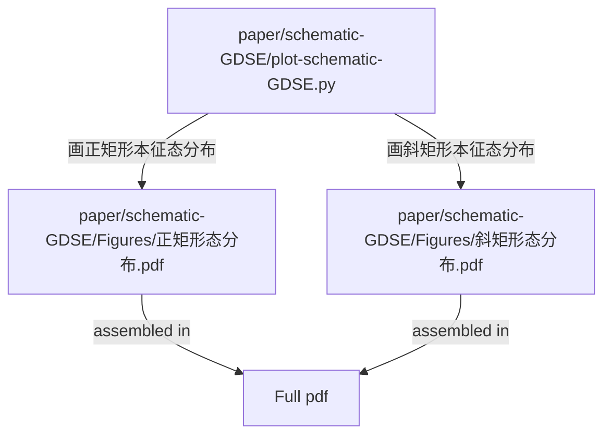

### Figure 2: Strip geometry and SGBZ constraint 

- Source: `paper/manu-and-supp/SGBZ-formulation-20260325.pdf`

The figure is pure schematic. 

### Figure 3: Relation between SGBZs and geometry-dependent bands

- Source: `paper/manu-and-supp/OBC-comparison-20250821.pdf`

The panels **a**, **b** are schematic, **c**, **d** are created using analytical solutions of the HN model, and **e**, **f** are numerical.

Related files, data and scripts:
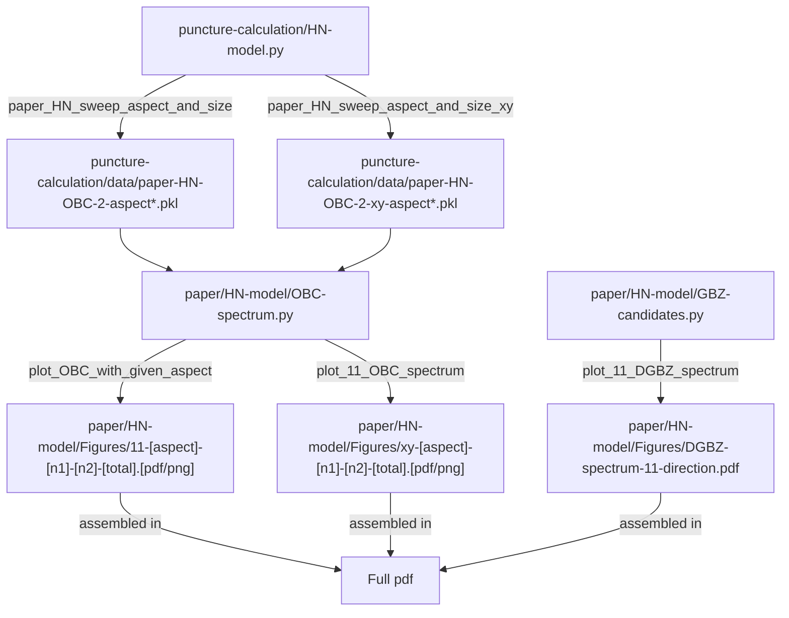

\* "DGBZ" is a deprecated name for "SGBZ"

### Figure 4: Criterion for uniform or geometry-dependent bands

- Source: paper/manu-and-supp/illustration-uniform-band-cond-20251014.pdf

The figure is pure schematic.

## Supplementary Information

### Figure S1: Schematics of the SGBZ

- Source: paper/manu-and-supp/main-idea-20250429.pdf
  
The figure is pure schematic.

### Figure S2: Distribution of the zeros of $F_{L_{2}}$ and properties of the major-axis winding number

- Source: paper/manu-and-supp/supp-SGBZ-formulation-20250901.pdf
  
The figure is pure schematic

### Figure S3: Comparison of $W(E,\mu_{1})$ and $W_{\text{q1D}}(E,\mu_{1},L_{2})/L_{2}$ in the 2D Hatano-Nelson model and the non-Hermitian Haldane model

- Source: paper/manu-and-supp/winding-number-numerical-20250906.pdf
  
The panels **a** and **c** are schematic, while **b** and **d** are numerical.

Related files:
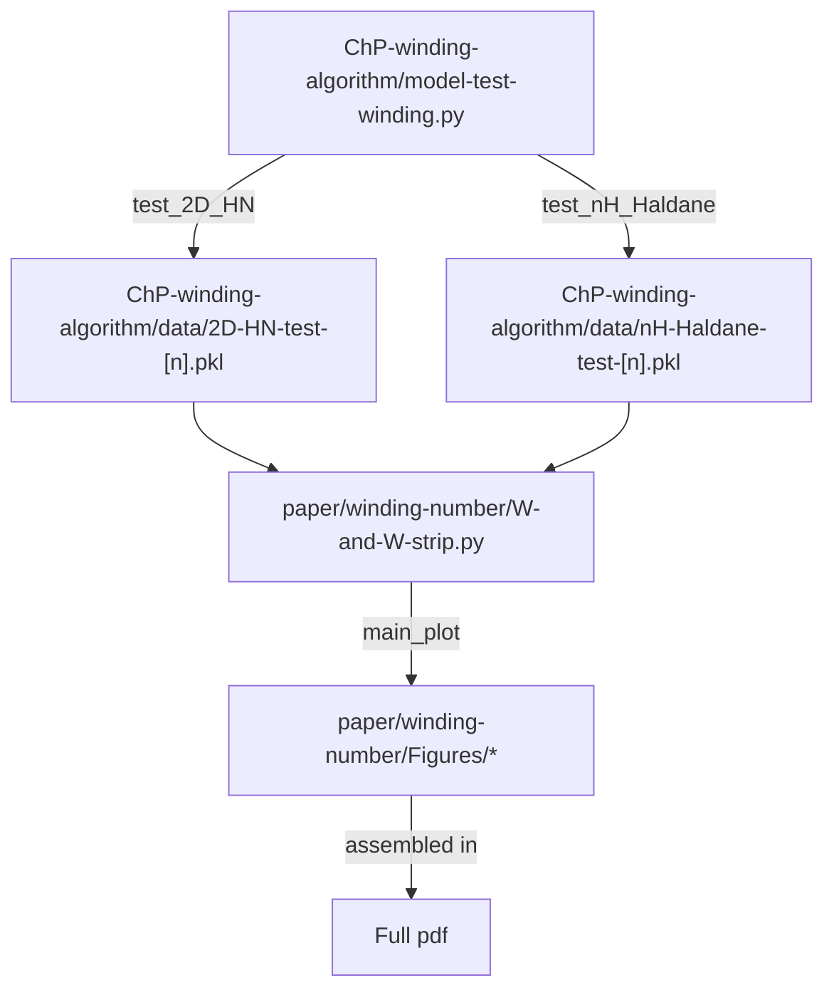

### Figure S4: SGBZ in higher dimensions

- Source: paper/manu-and-supp/higher-dim-SGBZ-2.pdf

The figure is pure schematic.

### Figure S5: Coordinate transformations of minor axes

- Source: paper/manu-and-supp/transformation-minor-20250919.pdf

The figure is pure schematic.

### Figure S6: Geometrical illustrations of equivalent formulations for $W(E,\mu_1)$

- Source: paper/manu-and-supp/winding-general-loop-20250527.pdf

The figure is pure schematic.

### Figure S7: Schematic diagrams of the 2D HN model, three special strips and the SGBZ bands

- Source: paper/manu-and-supp/HN-example-20250524.pdf

The panels **a**, **b**, **c**, **e** are schematic. The panels **d** and
**f** are the same as Figs. 3c and 3d in the main text (see the README
entry of Figure 3 for their codes and data).

### Figure S8: Comparison between SGBZs and QMGBZs

- Source: paper/manu-and-supp/quasi-1D-comparison-20250220.pdf

All panels are numerical. Panels **a**, **b**, **c** are the spectra of
the $[10]$-, $[01]$- and $[11]$-strip; panels **d**(i, ii), **e**(i, ii),
**f**(i, ii) are the major and minor complex momenta of the three strips.

Related files and scripts:
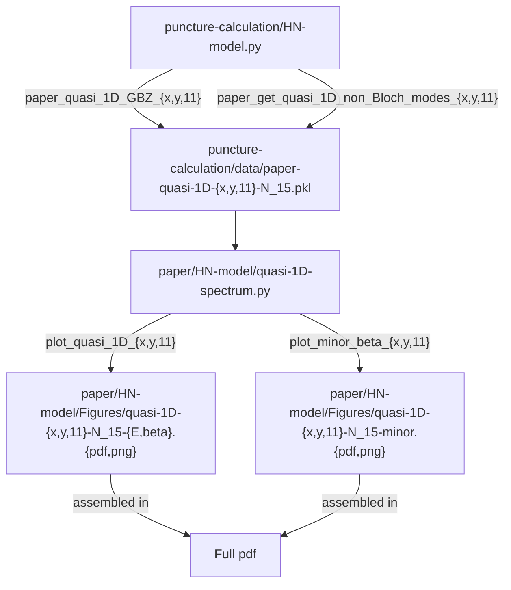

### Figure S9: Illustration of major-axis winding numbers in the 3D HN model

- Source: paper/manu-and-supp/higher-dim-HN.pdf

The figure is pure schematic.

### Figure S10: OBC spectra of the 2D HN model for different aspect ratios and sizes

- Source: paper/manu-and-supp/larger-size.pdf

All panels are numerical. Each panel is the density of states of the 2D
HN model in a parallelogram region spanned by the $[11]$-axis and the
$[01]$-axis, with the aspect ratio fixed along each row and the total
number of sites ($L_{1}L_{2}$) fixed along each column.

Related files and scripts:
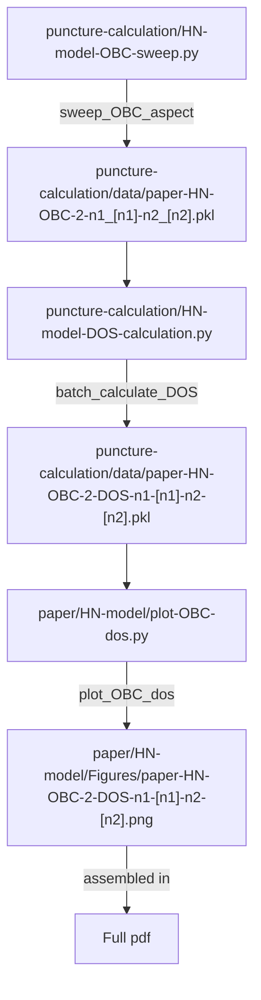

### Figure S11: Eigenstate distributions and the competition between incompatible SGBZs

- Source: paper/manu-and-supp/competition-SGBZ-20250919.pdf

The panels **a**--**e** are numerical, the panels **f** and **g** are
schematic. The coupling coefficients are the same as in Fig. S8, and the
eigenenergy of the eigenstate is $1.19+1.23 \mathrm{i}$.

Related files and scripts:
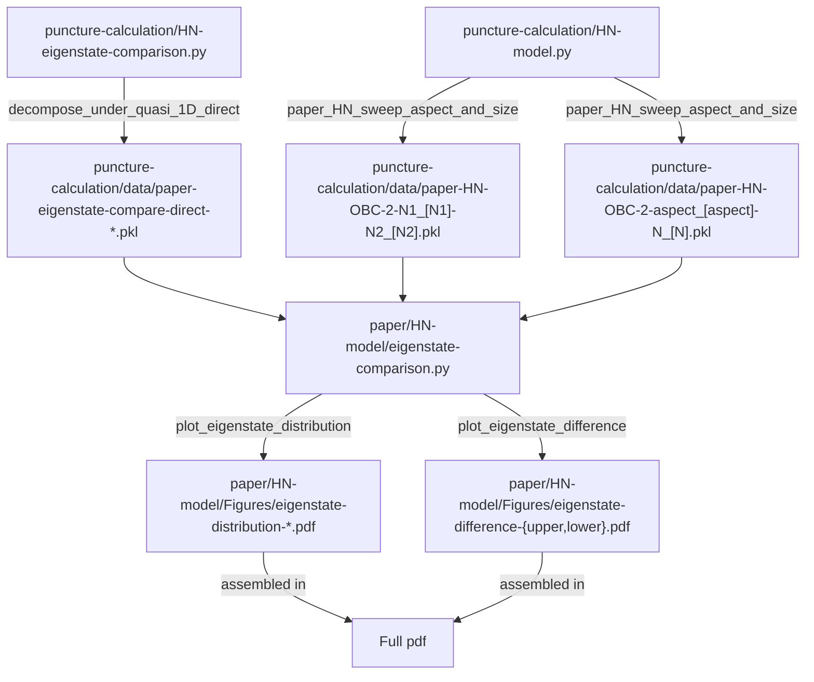

\* `paper-eigenstate-compare-direct-[n1]-[n2].pkl` stores the `(aspect,
n_feature)` pair of the finite-size OBC spectrum it was built from, and
`eigenstate-comparison.py` turns that pair back into a file name. The mapping
used by the published figure is

| comparison file | OBC spectrum |
|---|---|
| `paper-eigenstate-compare-direct-320-30.pkl` | `paper-HN-OBC-2-N1_320-N2_30.pkl` |
| `paper-eigenstate-compare-direct-320-40.pkl` | `paper-HN-OBC-2-aspect_0.125000-N_40.pkl` |
| `paper-eigenstate-compare-direct-320-50.pkl` | `paper-HN-OBC-2-N1_320-N2_50.pkl` |

Panels **a**--**c** are drawn from the row with shape $(L_{1},L_{2})=(320,40)$,
i.e. `paper-HN-OBC-2-aspect_0.125000-N_40.pkl`; panels **d**, **e** use all
three rows. That identification is not an assumption: the published panels
carry the axis label $n_{2}=40$ with $y$-ticks $0$ and $40$, and their tick set
and mesh geometry are reproduced exactly (identical bounding box, 64078 marker
operations) when this file is plotted. Note that the shape is $(320,40)$, so
the `aspect` value stored in the comparison file is the *aspect ratio* `0.125`
and not the `320` that one of the panels suggests - that is why the panels are
named `320-40` even though the file they come from is an `aspect_*` file.

### Figure S12: Geometry-dependent bulk spectra of the non-Hermitian Haldane model

- Source: paper/manu-and-supp/gain-loss-Haldane.pdf

The panels **a** and **d** are schematic. The panels **b**, **c** are
the $[10]$($[01]$)- and $[11]$-SGBZ spectra, and the panels **e**, **f**
are the OBC spectra in the square and the rhombus geometries.

Related files and scripts:
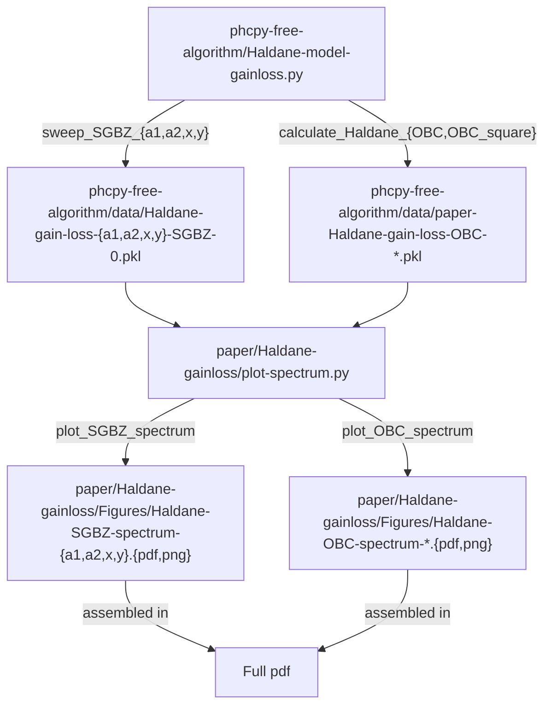

### Figure S13: OBC spectra and SGBZ for a model with exponentially decaying long-range hoppings

- Source: paper/manu-and-supp/long-range.pdf

All panels are numerical. The panels **a**--**c** are the OBC spectra in
three parallelogram geometries, the panel **d** shows $\mu_{x}$ (from the
$x$-SGBZ) and $\mu_{y}$ (from the $y$-SGBZ) as functions of $\mathrm{Re}(E)$,
and the panels **e**, **f** are the $x$-SGBZ and $y$-SGBZ spectra.

Related files and scripts:
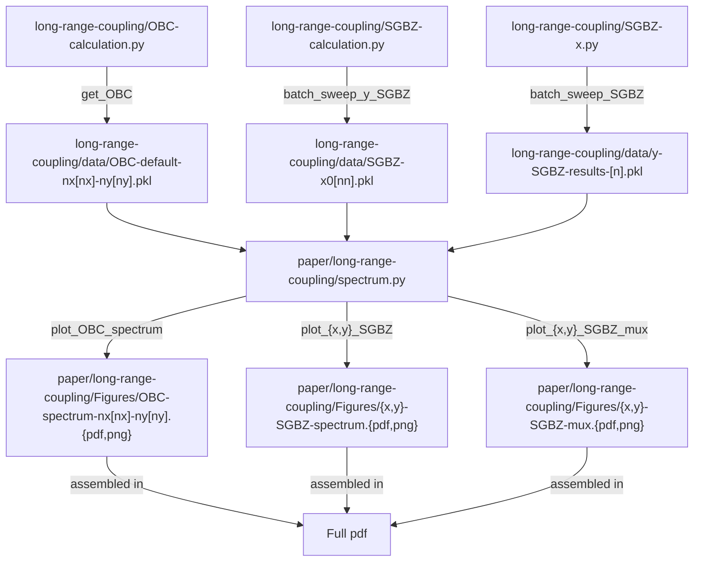

### Figure S14: Derivation of necessary conditions for uniform bands

- Source: paper/manu-and-supp/sfig-uniform-bands-cond-20251010.pdf

The figure is pure schematic.

### Figure S15: Properties of the zeros of $f$ and sufficient conditions for uniform bands

- Source: paper/manu-and-supp/ChP-zeros-20251004.pdf

The figure is pure schematic.

### Figure S16: General criterion in $n$-dimensional lattices

- Source: paper/manu-and-supp/nD-general-criterion-20251018.pdf

The figure is pure schematic.

### Figure S17: Characterization of the geometric dependence of the 2D HN model via the $[11]$-SGBZ

- Source: paper/manu-and-supp/example-uniform-bands.pdf

The panel **a** is schematic, while the panels **b**--**d** are numerical
(the spectrum, $\mu_{[11]}$ and $\mu_{y}$ of the $[11]$-SGBZ). They are
computed from the analytical expressions of the $[11]$-SGBZ, so no data
file is needed.

Related files and scripts:
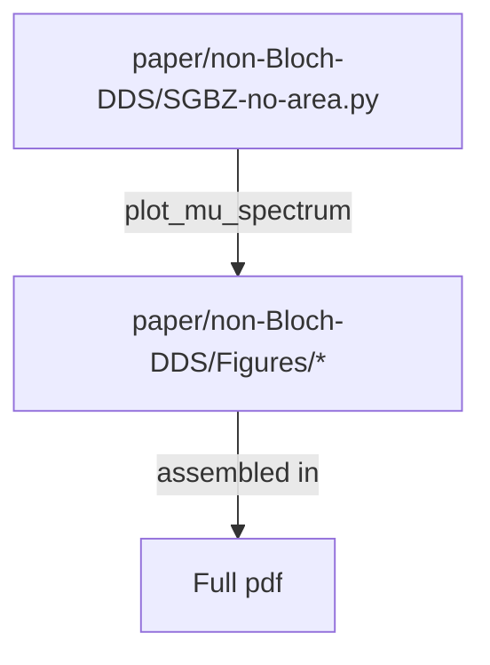

### Figure S18: Schematic diagram and spectra of the analytically solvable non-Hermitian model

- Source: paper/manu-and-supp/analytical-model.pdf

The panels **a** and **b** are schematic. The panel **c** shows the
analytical and numerical OBC spectra with the square geometry
($L_{x}=L_{y}=57$) together with the amoebic band, and the panel **d**
shows the numerical OBC spectrum with the diamond geometry.

Related files and scripts:
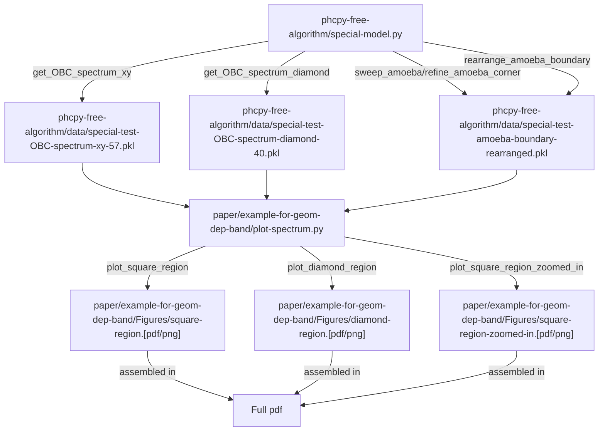

### Figure S19: Illustrations of the amoeba formulation

- Source: paper/manu-and-supp/Amoeba-schematics-20260208.pdf

All panels are numerical: the amoebas of the characteristic polynomial
for the reference energies $E=1+\mathrm{i}$ and $3+3\mathrm{i}$,
respectively.

Related files and scripts:
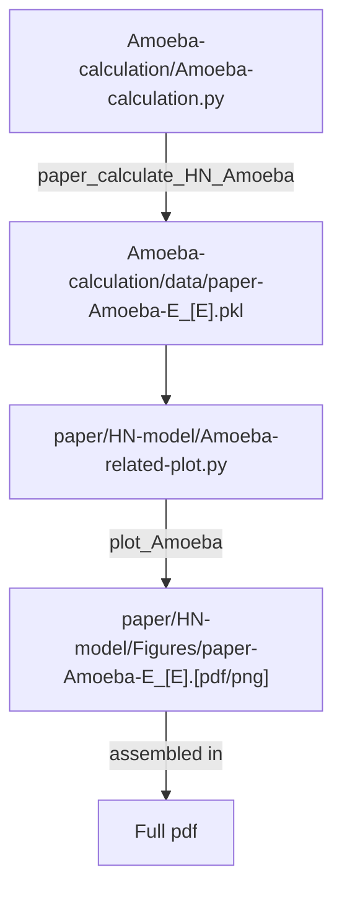

### Figure S20: Relation between amoeba and SGBZ formulations

- Source: paper/manu-and-supp/Amoeba-20260207.pdf

The panels **a**--**c** are schematic. The panel **d** shows the amoeba
spectrum together with the $[11]$-SGBZ spectra of the
2D HN model, and the panel **e** shows the $\beta_{y}$-zeros of the
characteristic polynomial at $\mu_{[11]}=\gamma_{x}+\gamma_{y}$ for the
three reference energies.

Related files and scripts:
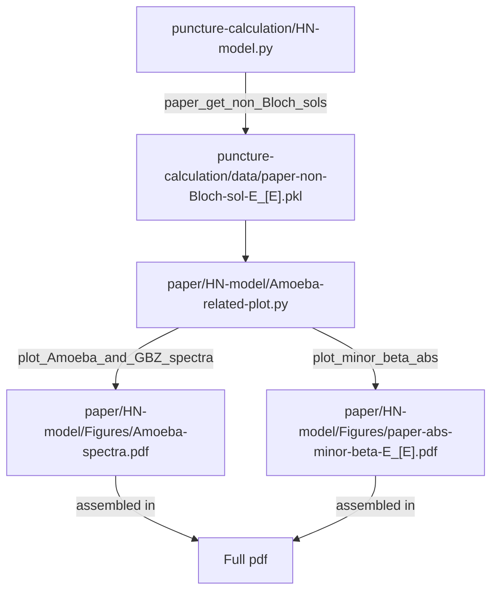

### Figure S21: Illustration of the compatibility of 1D GBZ constraints

- Source: paper/manu-and-supp/GBZ-compatibility.pdf

The figure is pure schematic.

### Figure S22: Schematic diagram of the GFS framework

- Source: paper/manu-and-supp/GFS-algebraic-260318.pdf

The figure is pure schematic.

### Figure S23: Spectral area of BZ bands

- Source: paper/manu-and-supp/spectral-area.pdf

The panels **a** and **b** are schematic, while the panel **c** is
numerical: the BZ spectra of the 2D HN model and of the uniform-band
model, respectively, compared with the SGBZ/OBC spectrum.

Related files and scripts:
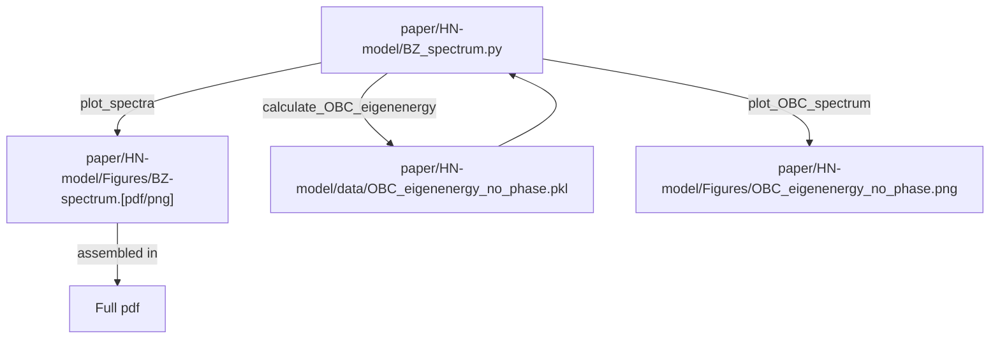

\* The BZ spectrum is computed analytically inside `BZ_spectrum.py`; the
data file `OBC_eigenenergy_no_phase.pkl` is to check the equivalence between the OBC spectrum and SGBZ spectrum.
